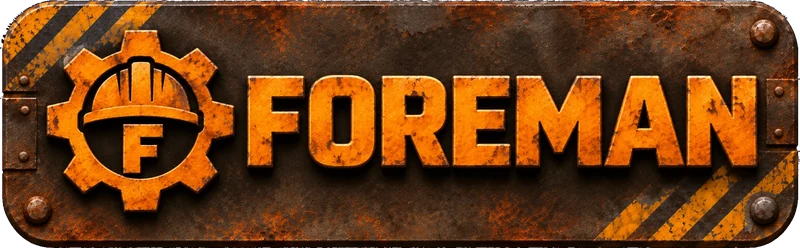

# Foreman

[](https://github.com/toddawhittaker/foreman/actions/workflows/ci.yml)

Foreman (a working name) is a small, self-hosted web app that runs
Factorio servers through Docker. It manages **worlds**: a world is a map
with its own mods, settings and pinned game version. You switch between
worlds with one click, and every risky change takes a snapshot first so
a save is never lost.

## Status

Early development; no image is published yet, so you build it yourself
(`make image`). Built so far: sign-in, worlds and snapshots, server
control, switching worlds and game versions, generating worlds, game
settings, languages and mods. See [docs/STATUS.md](docs/STATUS.md)
for what each epic has delivered, and [docs/SPEC.md](docs/SPEC.md),
section 18, for the epic order.

The web UI is available in eight languages. The translations are made by
AI, and corrections are welcome as GitHub issues.

## Running Foreman

Foreman runs in a container next to a Docker socket proxy, and creates the
game's container itself, one exact Factorio version per world. You build
the image with `make image` (tagged `foreman:dev`), give Foreman a data
directory owned by 845:845, and start it with Docker Compose.

The [operator guide](docs/OPERATOR.md) covers everything else: what you
need, the compose file, the security advice (Docker access is root on the
host), running behind a reverse proxy, first sign-in, generating a world,
installing mods, joining the game, importing and switching worlds, and
what to do when something fails.

## Documentation

- [docs/VISION.md](docs/VISION.md): what Foreman is for, its principles
  and its non-goals.
- [docs/OPERATOR.md](docs/OPERATOR.md): how to install and run Foreman.
- [docs/SPEC.md](docs/SPEC.md): the numbered requirements.
- [docs/STACK.md](docs/STACK.md): the technology choices and why.
- [docs/DESIGN.md](docs/DESIGN.md): the user interface design rules.
- [docs/WORKFLOW.md](docs/WORKFLOW.md): branches, pull requests, checks
  and local development.
- [docs/I18N.md](docs/I18N.md): the languages, the glossary and the rules
  for writing and translating text.
- [docs/adr/](docs/adr/): decision records.

## Development

You need Go 1.27.3 (exactly; see WORKFLOW.md, "Local development"),
Docker and `make`. The linter and the browser tests run in pinned
containers, so you do not install them.

```sh
make verify   # format, vet, lint, unit tests with coverage, e2e type check
make run      # serve locally on http://localhost:8080
make e2e      # browser and accessibility tests
make image    # build the container image as foreman:dev
```

CI runs `make ci` on every pull request and on every push to `main`.

## License

[MIT](LICENSE).
