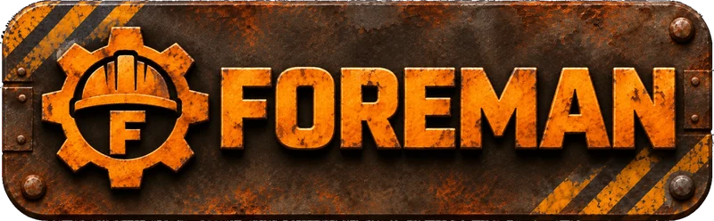
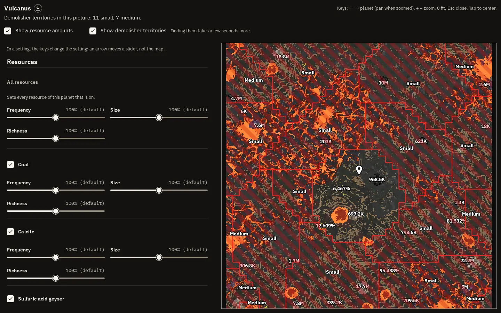
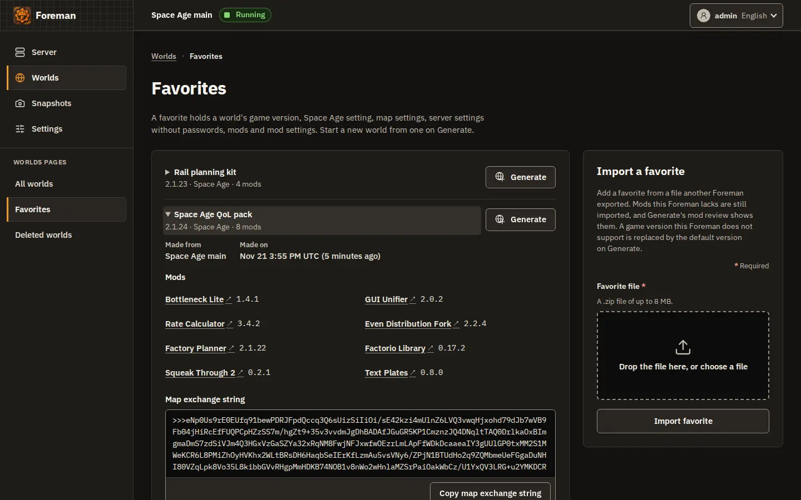
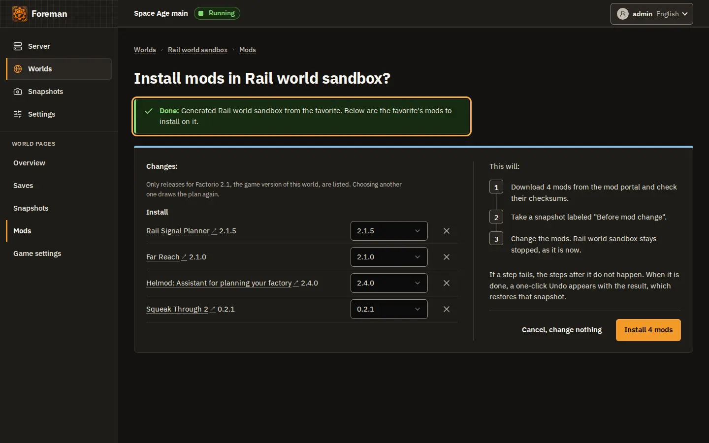
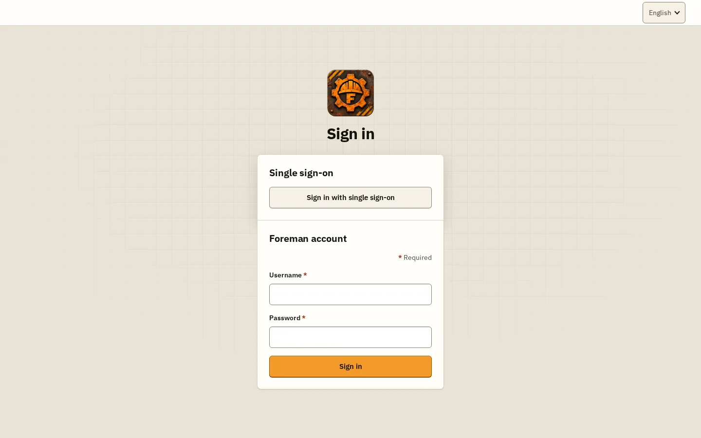
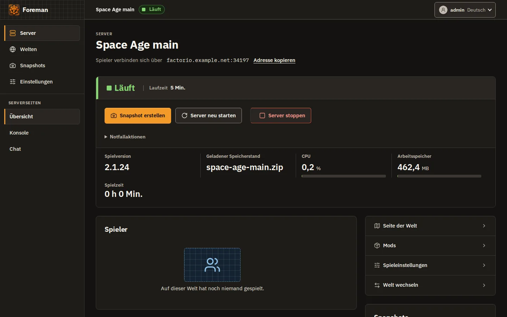
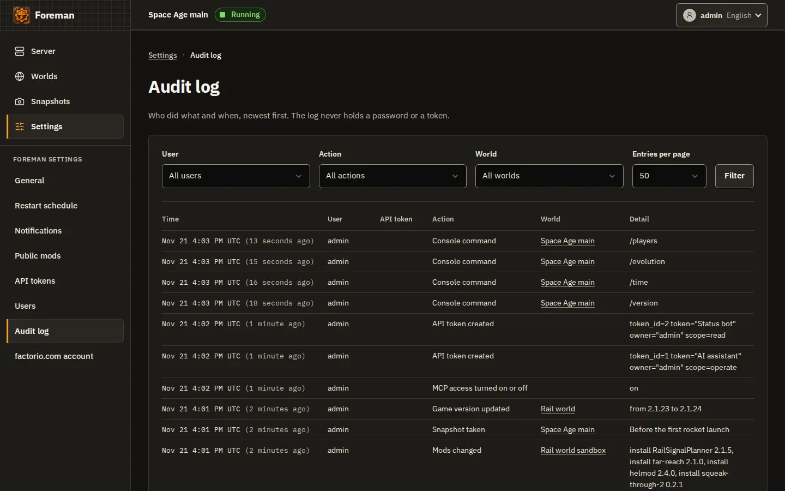
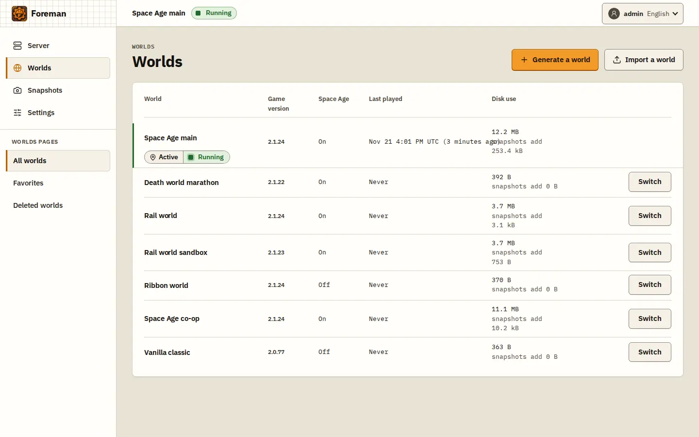
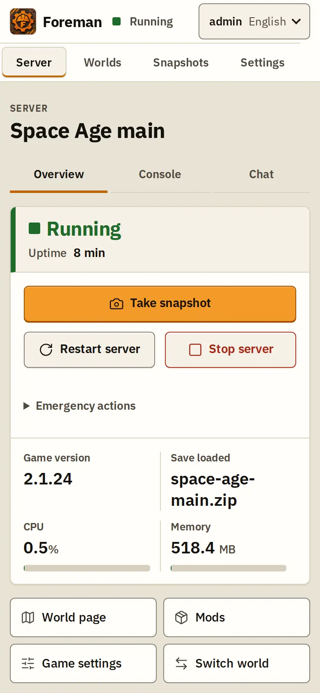
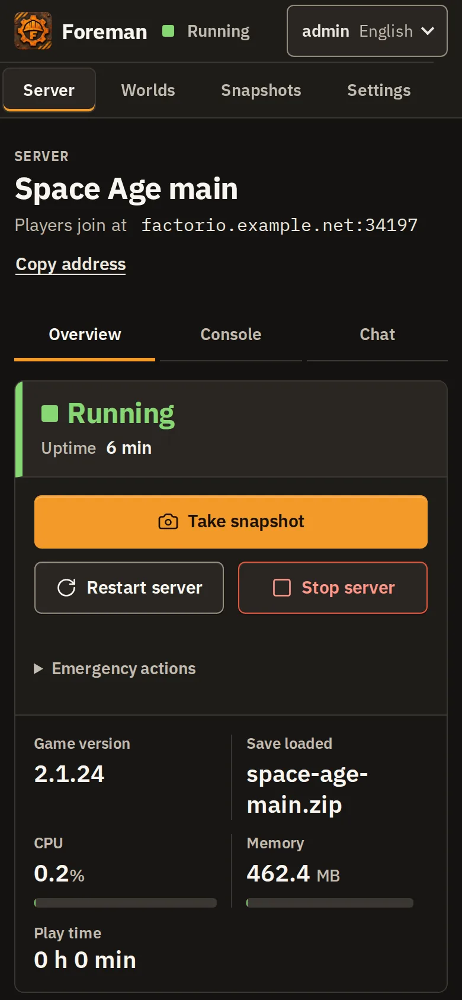

# Foreman

[](https://github.com/toddawhittaker/foreman/actions/workflows/ci.yml)
[](AI-DISCLOSURE.md)

Foreman (a working name) is a small, self-hosted web app that runs
Factorio servers through Docker.

It manages **worlds**. A world is a map together with its own mods, its
own settings and its own pinned game version, so a modded Space Age run
and a vanilla 1.1 map can live side by side and never break each other.
You switch between them with one click.

Every risky change, such as switching worlds, changing mods, updating the
game or restoring an old save, takes a **snapshot** of the world first. A
snapshot is a complete copy of the world's folder, so a bad mod update or
a wrong click is undone in one click, and a save is never lost.


## Features

### Worlds, versions and snapshots

- **Worlds with pinned game versions.** Each world runs on the exact
  Factorio version it was made with, from 1.1 to 2.1. Switching to another
  world stops the game, takes a snapshot of both worlds, and starts the
  new one on its own version. Foreman downloads a game image only when
  you ask it to.
- **Updating the game, with a way back.** Updating a world's game version
  takes a snapshot first, and rolling back restores it in one step.
- **Automatic snapshots** before every risky change, plus snapshots you
  take by hand. You choose how many automatic snapshots each world keeps.
- **Import, clone and archive.** Import a world you already have from a
  folder or a save upload, clone a world to try something on a copy, and
  archive the worlds you no longer play. A deleted world can be restored
  from the Deleted worlds page.


### Generating worlds, with a real map preview

Generate a world from a preset or from your own map settings, and see the
map before you commit to it. The preview is drawn by the real game, not
an imitation, so what you see is the map you get.

- **Resource patches are labelled with their amounts**, such as "1.2M",
  on the map, with the same list as text for keyboard and screen-reader
  users.
- **Space Age planets.** On Vulcanus, the preview draws the demolisher
  territories, so you can see where the big worms live before you land.




### Mods

- **Mods from the mod portal**, searched from the world's Mods tab. Only
  mods that fit the world's game version are listed.
- **Dependency resolution.** Foreman works out every mod your picks
  need, shows one plan of what it will install, and takes a snapshot
  before it changes anything. Mod settings can be changed on the same
  tab.
- **Favorites.** Save a world's mods, mod settings, map settings and
  server settings as a favorite, then generate new worlds from it with
  the same mod bundle in a few clicks.
- **A public mods page for players.** Turn it on, and players can see and
  download the running world's mods without signing in. Nothing else is
  shown there.






### Running the server

- **Start, stop and restart** with a countdown that warns players in the
  game's chat. After a crash the game is restarted, and after three
  crashes in ten minutes Foreman stops it and says so.
- **Live operations**: the player list, kicking and banning players, the
  game's chat and console, and the game's log as it is written.
- **A daily restart schedule** that waits until nobody is online.
- **Webhooks** to Discord, ntfy, Pushover or any web address, for starts,
  stops, crashes, players joining and leaving, and more.
- **A low-disk warning** before the game's autosaves are at risk.
- **An optional VPN sidecar**, so players can join through Tailscale or
  another VPN while LAN players still join the host.

### AI assistants through MCP

Foreman has an MCP (Model Context Protocol) endpoint, so an AI assistant
such as Claude Code can read the server's state and run it for you. Each
assistant gets its own token with a scope: **Read** only looks,
**Operate** can also start, stop and switch, and **Admin** can change
worlds, mods and settings. Actions that delete or overwrite something
show a preview and need a second, confirming call. Everything a token
does is in the audit log under its name.


### Sign-in, languages and the interface

- **Three ways to sign in**: a local username and password; trusted
  headers from a reverse proxy that signs people in for Foreman; or
  OpenID Connect (OIDC), a standard single sign-on protocol, with any
  provider that speaks it. You can turn on more than one.
- **An audit log** of who did what, with filters and a retention setting.
  Actions an AI assistant takes are listed under its token's name.
- **Eight languages**: English, German, Russian, Simplified Chinese,
  French, Spanish, Polish and Czech. The translations are made by AI, and
  corrections are welcome as GitHub issues.
- **Works on a phone**, down to 320 pixels wide, in light and dark mode.
  Pages are built and tested for keyboard and screen-reader use.









<table>
  <tr>
    <td></td>
    <td></td>
  </tr>
</table>

## Quick start

You need a Linux host with Docker and Docker Compose. Foreman runs in a
container next to a Docker socket proxy (a small container that passes
on only the Docker requests Foreman needs), and creates the game's
container itself.

The image is published as `ghcr.io/toddawhittaker/foreman`, with exact
version tags only. Until the first release is published, building from
source with `make image` is the only way to get it (operator guide,
section 2).

1. Make a data directory owned by user and group 845:

   ```sh
   mkdir -p data && sudo chown 845:845 data
   ```

2. Copy the compose file from the [operator guide](docs/OPERATOR.md),
   section 5, next to `data/`, and set its image to the newest release
   from the [releases page](https://github.com/toddawhittaker/foreman/releases),
   for example `ghcr.io/toddawhittaker/foreman:1.0.0`.
3. Start it with `docker compose up -d`, open `http://<your host>:8080`,
   and create the first admin account.

Read the operator guide's security advice (section 4) before you put
Foreman anywhere but a home network you trust: access to Docker is root
on the host. The guide then covers the rest: a reverse proxy, generating
a world, installing mods, joining the game, upgrades, backups and every
setting.

## Documentation

- [docs/VISION.md](docs/VISION.md): what Foreman is for, its principles
  and its non-goals.
- [docs/OPERATOR.md](docs/OPERATOR.md): how to install and run Foreman.
- [docs/SPEC.md](docs/SPEC.md): the numbered requirements.
- [docs/STACK.md](docs/STACK.md): the technology choices and why.
- [docs/DESIGN.md](docs/DESIGN.md): the user interface design rules.
- [docs/WORKFLOW.md](docs/WORKFLOW.md): branches, pull requests, checks
  and local development.
- [docs/I18N.md](docs/I18N.md): the languages, the glossary and the rules
  for writing and translating text.
- [docs/adr/](docs/adr/): decision records.
- [AI-DISCLOSURE.md](AI-DISCLOSURE.md): where AI helps make Foreman,
  and what Foreman itself does not do.

## Development

You need Go 1.27.4 (exactly; see WORKFLOW.md, "Local development"),
Docker and `make`. The linter and the browser tests run in pinned
containers, so you do not install them.

```sh
make verify   # format, vet, lint, unit tests with coverage, e2e type check
make run      # serve locally on http://localhost:8080
make e2e      # browser and accessibility tests
make image    # build the container image as foreman:dev
```

CI runs `make ci` on every pull request and on every push to `main`.

## License

[MIT](LICENSE).
